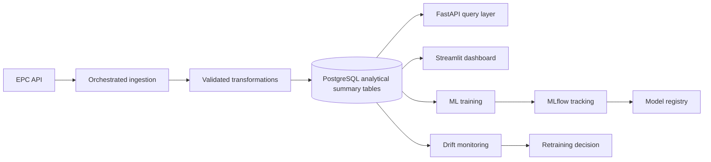

# Architecture

## Current Architecture

The current system is a file-backed reproducible analytics pipeline:

```text
Prefect flow
  -> EPC API
  -> downloaded ZIP files
  -> extracted certificates.csv files
  -> merged core CSV
  -> cleaned South West CSV
  -> feature/model-ready CSV
  -> figures, tables, models, validation reports, manifests, registry entries
  -> optional MLflow experiment tracking
  -> lightweight drift monitoring and retraining recommendation reports
  -> optional PostgreSQL analytical summary tables
  -> Streamlit dashboard and FastAPI endpoints
```

The reliable execution path is the CLI:

```bash
ewhei run-all
```

or the Prefect-orchestrated flow:

```bash
ewhei orchestrate --mode la
```

Individual commands remain available:

```bash
ewhei download --mode la
ewhei clean
ewhei features
ewhei eda
ewhei fe
ewhei train
ewhei validate
ewhei manifest
ewhei db-init
ewhei db-load
ewhei train --track
ewhei monitor
```

## Pipeline Components

- `config.py`  
  Central paths, South West geography mapping, EPC band scores, fuel maps, and
  tenure maps.

- `scripts/pipeline/epc_download_merge_fast.py`  
  Authenticates with the EPC API, selects domestic bulk files, downloads ZIPs,
  extracts certificates, and writes a merged core CSV.

- `scripts/pipeline/clean_epc.py`  
  Filters South West records, performs geography rollup, standardises categories,
  creates core analytical flags, and applies simple sanity filters.

- `scripts/pipeline/build_features.py`  
  Adds imputation, missingness flags, policy periods, log floor area, and
  new-build share.

- `scripts/pipeline/report_eda.py`  
  Produces descriptive figures and tables.

- `scripts/pipeline/run_did.py`  
  Runs fixed-effects policy-period models, event-study style year coefficients,
  heterogeneity views, and local-authority clustering.

- `scripts/pipeline/train_models.py`  
  Trains regression and classification models, writes metrics, feature importance,
  SHAP plots, model artifacts, and model cards. Optionally logs params, metrics,
  artifacts, and supported model objects to MLflow.

- `src/ew_housing_energy_impact/validation.py`  
  Checks schema, year bounds, numeric ranges, missingness summaries, and
  geography coverage.

- `src/ew_housing_energy_impact/manifest.py`  
  Writes dataset metadata such as rows, columns, years, authorities, and policy
  period counts.

- `src/ew_housing_energy_impact/registry.py`  
  Appends artifact registry entries with timestamps, paths, metadata, and SHA256
  hashes.

- `app.py`  
  Streamlit dashboard over generated pipeline outputs.

- `api.py`  
  Lightweight FastAPI analytics service over generated outputs, optional
  PostgreSQL summary tables, validation/artifact metadata, model metrics, and
  drift/retraining recommendation reports.

- `src/ew_housing_energy_impact/db/*`  
  Optional SQLAlchemy analytical layer for summary tables, validation metadata,
  artifact registry rows, and model metrics. CSV/report outputs remain the source
  artifacts.

- `src/ew_housing_energy_impact/orchestration/flows.py`  
  Defines the Prefect `epc_pipeline_flow` that runs the pipeline stages in
  dependency order.

- `src/ew_housing_energy_impact/orchestration/tasks.py`  
  Defines Prefect task wrappers around the existing script entry points.

- `src/ew_housing_energy_impact/ml/tracking.py`  
  Optional MLflow tracking helpers with lazy imports and no-op behaviour when
  tracking is disabled.

- `src/ew_housing_energy_impact/monitoring/*`  
  Lightweight drift checks and threshold-based retraining recommendations over
  reference/current feature CSVs. This writes monitoring reports; it does not
  retrain models automatically.

## Key Design Decisions

### Keep Transformations Scriptable

The project remains runnable from the command line and from CI. This keeps the
pipeline reproducible without requiring notebook execution.

### Wrap Existing Logic Instead Of Rewriting It

Prefect orchestration calls the existing pipeline entry points. This adds task
ordering, logs, dry-run planning, skip flags, and failure boundaries without
duplicating transformation logic.

### Keep Postgres Optional

The database layer loads summary outputs from generated CSV/report artifacts. It
does not replace the pipeline outputs or ingest full raw EPC certificate data.
FastAPI uses Postgres only when `ENABLE_DATABASE=true`; otherwise it falls back to
CSV reads.

### Keep API Fallbacks Explicit

The API prefers the optional analytical database for summary reads when it is
enabled and reachable. If the database is unavailable, it logs a warning and falls
back to generated CSV/report artifacts where possible. Optional endpoints such as
validation, artifacts, model metadata, drift, and retraining status return clear
empty states when their source artifacts have not been generated yet.

### Keep MLflow Optional

Training remains local-file compatible by default. MLflow is activated only by
`ENABLE_MLFLOW=true` or `ewhei train --track`, and failures are explicit when
tracking is requested but MLflow is unavailable.

### Keep Monitoring Lightweight

Monitoring is a local report-generation step, not a service dependency. It
compares generated feature datasets, writes JSON/Markdown reports, and recommends
whether retraining should be considered. The recommendation is operational and
threshold based; it does not imply statistical significance or trigger retraining.

### Use A Single Geography Source Of Truth

The South West mapping lives in `config.py`, and both download selection and
cleaning use it. This prevents a common failure mode where the ingestion step and
analysis step disagree about which authorities belong in scope.

### Preserve Raw Identifiers

Cleaning overwrites `LOCAL_AUTHORITY` and `LOCAL_AUTHORITY_LABEL` with rolled-up
analysis authorities, but preserves raw EPC values in `LOCAL_AUTHORITY_RAW` and
`LOCAL_AUTHORITY_LABEL_RAW`. This supports both stable panel modelling and
traceability back to source labels.

### Keep Validation Close To The Dataset

Validation runs against the modelling-ready dataset and checks the fields that
downstream analysis depends on. This makes failures visible before modelling or
serving.

## Why Geography Rollup Matters

EPC data is published at lower-tier or unitary authority level. Some dissertation
analysis authorities, such as Devon, Gloucestershire, Somerset, Dorset, and
Bournemouth Christchurch and Poole, require rolling up multiple historical or
lower-level authorities.

If the pipeline used county council codes directly, it would miss EPC bulk files.
If it failed to roll authorities up consistently, fixed-effects models and trend
tables would mix incompatible geography levels. The rollup layer is therefore a
core correctness feature, not a cosmetic transformation.

## Why Property-Level Train/Test Split Matters

The same physical dwelling can receive multiple EPC certificates over time. A
random row-level split can place one certificate for a property in training and
another certificate for the same property in testing. That leaks property-specific
information and inflates model metrics.

The modelling code uses `BUILDING_REFERENCE_NUMBER` to split by property, so the
test set better represents unseen dwellings.

## Why Validation And Artifact Registry Matter

The project generates many downstream outputs: figures, tables, model artifacts,
model cards, quality reports, and manifests. Without validation and registry
metadata, it is hard to know whether outputs were produced from a complete,
reasonable dataset.

Validation checks data shape and numeric ranges. The manifest records dataset
metadata. The registry records artifact paths, timestamps, metadata, and hashes.
Together, these make the analysis more reproducible and easier to audit.

## Future Architecture Roadmap

The next platform phases should add production infrastructure while preserving the
tested transformation logic:



Planned upgrades:

- optional remote Prefect deployment with schedules, retries, and work pools
- Alembic migrations and richer warehouse modelling
- MLflow model registry and promotion workflow
- scheduled monitoring and richer statistical drift tests
- retraining trigger workflow with human-approved deployment gates
- authenticated API access, pagination, and prediction endpoints
- dashboard queries served from analytical tables rather than CSV reads
